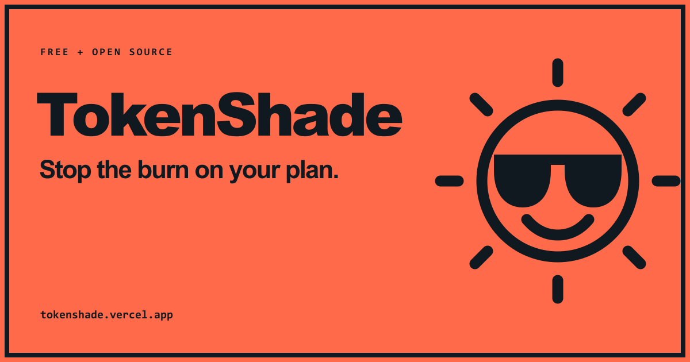
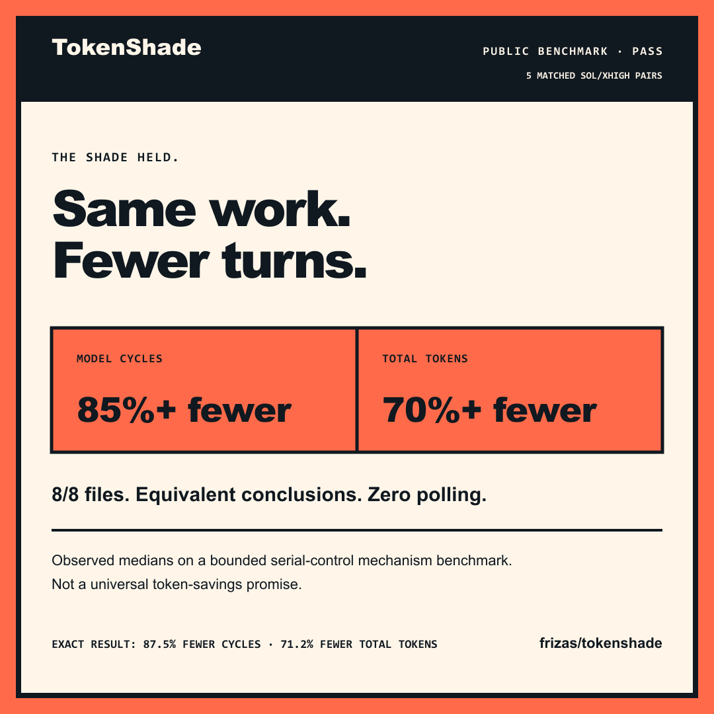

<p align="center">
  <a href="https://tokenshade.vercel.app">
    <picture>
      <source media="(prefers-color-scheme: dark)" srcset="./assets/logo-light.svg">
      <source media="(prefers-color-scheme: light)" srcset="./assets/logo-dark.svg">
      
    </picture>
  </a>
</p>

<h1 align="center">TokenShade</h1>

<p align="center"><strong>Stop the burn on your plan.</strong></p>

<p align="center">
  TokenShade helps your coding agent batch independent tool calls and stop
  wasting full model turns on repetitive polling.
</p>

<p align="center">
  <a href="https://tokenshade.vercel.app"><strong>Website</strong></a> ·
  <a href="#install-in-60-seconds"><strong>Install</strong></a> ·
  <a href="./docs/HONEST-NUMBERS.md">Honest numbers</a> ·
  <a href="./docs/PORTABILITY.md">Other agents</a> ·
  <a href="./SECURITY.md">Security</a>
</p>

<p align="center">
  Free forever · No plugin tracking · Open source · MIT licensed
</p>

<p align="center">
  <a href="https://tokenshade.vercel.app">
    
  </a>
</p>

## Install in 60 seconds

```text
codex plugin marketplace add frizas/tokenshade
codex plugin add tokenshade@tokenshade
```

Restart Codex, then ask:

```text
@tokenshade install
```

TokenShade previews the change, preserves every instruction outside its exact
marker block, and makes a content-hash backup before editing an existing policy
file. You can dry-run, inspect status, update, or remove it cleanly.

## Four reads should not need four model loops

<table>
  <thead>
    <tr>
      <th>Without shade</th>
      <th>With TokenShade</th>
    </tr>
  </thead>
  <tbody>
    <tr>
      <td><code>model → read → model → read → model → read → model → read</code></td>
      <td><code>model → [ read · read · read · read ] → model</code></td>
    </tr>
    <tr>
      <td>Independent calls can re-enter the model one by one.</td>
      <td>Already-known independent calls share one tool stage.</td>
    </tr>
  </tbody>
</table>

Every unnecessary return can make the model process the same context again.
Rapid “are you done yet?” polling can add more turns without adding
information. TokenShade changes that orchestration pattern—not the work itself.

## Three narrow rules

| | Rule | Guardrail |
|---:|---|---|
| **01** | Group two or more independent, already-known calls in one tool stage. | Inspect every result; never invent work to fill a batch. |
| **02** | Keep dependencies, exploration, approvals, conflicting writes, waits, and resumes sequential. | Safety and causality stay intact. |
| **03** | Give long-running commands a meaningful initial wait and polling cadence. | No turn-burning stream of status checks. |

## Measured, not promised

Across five matched GPT-5.6 Sol/XHigh serial-control/TokenShade pairs:

| Metric | Serial control median | TokenShade median | Observed change |
|---|---:|---:|---:|
| Model cycles | 8 | 1 | **87.5% fewer** |
| Total tokens | 243,314 | 70,085 | **71.2% fewer** |
| Fixture coverage | 8 / 8 every run | 8 / 8 every run | Equivalent |
| Conclusions | Same three every run | Same three every run | Equivalent |

<p align="center">
  
</p>

Every treatment run genuinely grouped all eight reads. No run polled or
expanded scope. The fixture, fixed prompt, expected findings, sanitized
per-run metrics, environment versions, hashes, and reproduction command are
committed in this repository.

These are observed medians from a bounded mechanism benchmark. They are not a
universal savings promise or a comparison against default Sol. In the retained
unguided preflight, Sol already grouped most baseline runs, so median model
cycles were neutral. Read the full method and limitations in
[Honest Numbers](./docs/HONEST-NUMBERS.md).

## What TokenShade never touches

TokenShade does **not** change your:

- model or reasoning effort;
- permissions, sandbox, or approval gates;
- memory or existing instructions outside its marker block;
- prompts, credentials, or file contents; or
- production systems.

The plugin has no telemetry, backend, hooks, MCP server, credential reads, or
runtime network client. The installer is dependency-free Node.js 20+ and works
on Windows, macOS, and Linux. The public website uses opt-in Google Analytics
only after a visitor allows it. See [Privacy](./PRIVACY.md),
[Security](./SECURITY.md), and the [architecture](./docs/ARCHITECTURE.md).

## Bring your own agent

Codex is the measured target. TokenShade also includes:

- `policy/AGENTS.md` for a portable Codex install;
- `policy/PORTABLE.md` for agent-neutral hosts;
- `adapters/claude/CLAUDE.md` for Claude Code;
- `adapters/kimi/AGENTS.md` for Kimi Code CLI; and
- a one-session prompt for ChatGPT Work.

Those paths are labeled compatible—not benchmarked—until they receive their own
matched evidence. Ordinary ChatGPT chats without agent tools have nothing to
batch. See [Portability](./docs/PORTABILITY.md) and
[Prompts](./PROMPTS.md).

## Prefer to build your own?

The plugin is the recommended path, but you do not need us. Paste this
one-tweet prompt into your agent:

```text
Build me a TokenShade skill from https://tokenshade.vercel.app. Layer its batching and polling rules over my setup; preserve existing instructions. Keep dependencies, exploration, approvals, conflicting writes, waits, and resumes sequential. Show a dry-run and diff first.
```

AI-readable context is also available in [`llms.txt`](./llms.txt).

## What ships

- `@tokenshade` — safe install, update, status, recovery, and removal.
- `@tokenshade-audit` — aggregate local orchestration metrics without prompts,
  file contents, paths, or credentials.
- `@tokenshade-benchmark` — reproducible before/after testing on the public
  eight-file fixture.
- A marker-safe, hash-backed-up, dependency-free Node.js utility.
- Native Codex marketplace metadata and portable policy adapters.

### Instruction-only fallback

Clone the repository and run:

```text
node plugins/tokenshade/scripts/tokenshade.mjs install --dry-run --json
node plugins/tokenshade/scripts/tokenshade.mjs install --json
node plugins/tokenshade/scripts/tokenshade.mjs status --json
node plugins/tokenshade/scripts/tokenshade.mjs uninstall --dry-run --json
node plugins/tokenshade/scripts/tokenshade.mjs uninstall --json
```

## Development

```text
npm test
npm run check
npm run benchmark -- --dry-run
```

The landing page lives in `site/`. It uses the Sites Vinext runtime for local
previews and a static Next.js export for the public Vercel deployment.

## Independence

TokenShade is independent open-source software for OpenAI Codex and ChatGPT
Work-compatible agent setups. It is not affiliated with or endorsed by OpenAI.
“OpenAI,” “ChatGPT,” “Codex,” and model names are used descriptively.

<p align="center">
  Proudly made with AI by <strong>HiLeverage Studios</strong><br>
  MIT © <a href="https://github.com/frizas">frizas</a>
</p>
